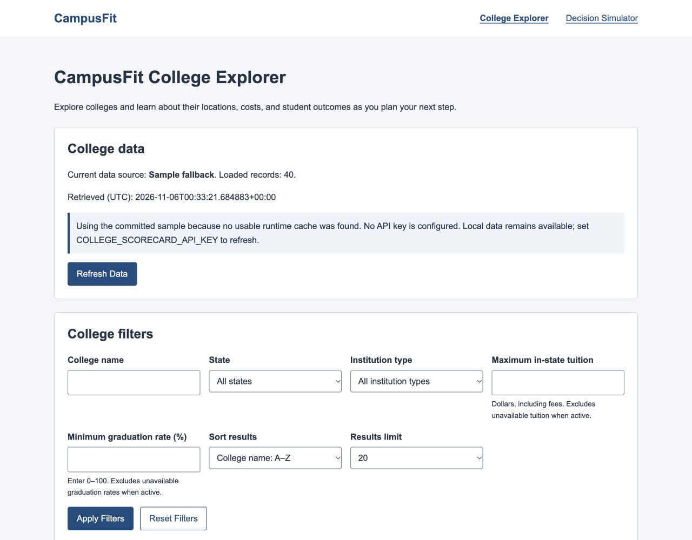

# CampusFit

A Flask application for exploring colleges and developing preference-based comparisons using official College Scorecard data.

**San José State University · CS 122 — Advanced Programming with Python**

**Project partners:** Yug Amol More and Sean Aminov

## Project overview

Students comparing colleges must consider location, tuition, graduation rates, and
student outcomes, often across different sources and reporting years. CampusFit
organizes public U.S. Department of Education College Scorecard information in one
interface. The College Explorer lets students search institutions, combine filters,
and examine available costs and outcomes.

The planned Decision Simulator will let students adjust personal priorities and
compare colleges through weighted rankings and charts. This CS 122 final project
connects Python web-data access, local data organization, a Flask interface, and
planned analysis and visualization. The Explorer and data workflow are complete;
the simulator and analysis remain under development.

## Current project status

| Component | Status | Owner |
|---|---|---|
| College Scorecard data retrieval | Complete | Yug Amol More |
| Local CSV and metadata storage | Complete | Yug Amol More |
| College Explorer | Complete | Yug Amol More |
| Filtering and sorting | Complete | Yug Amol More |
| Partner data contract | Complete | Yug Amol More |
| Decision Simulator | In development; placeholder only | Sean Aminov |
| Weighted college analysis | In development | Sean Aminov |
| Data visualization | In development | Sean Aminov |

## Features

### Completed

- Official College Scorecard API retrieval, bounded to a nationally distributed
  selection of up to 300 large operating institutions.
- Validated local CSV records, separate JSON metadata, and preservation of the
  last usable cache when refresh fails.
- A genuine committed sample for demonstrations without an API key or live access.
- College-name, state, institution-type, maximum in-state tuition, and minimum
  graduation-rate filters that can be combined.
- Six sort options and limits of 10, 20, 50, or all matching local records.
- Honest missing-value display, input validation, result counts, and manual refresh.
- Shared Flask/Jinja pages with responsive controls, a horizontally scrollable
  results table, labeled inputs, and visible keyboard focus.

### In development

Sean's assigned work includes preference-based weighted ranking, the What-If
Decision Simulator, and college comparison charts. The simulator route currently
shows a temporary placeholder; no ranking, analysis, or visualization is implemented.

## Screenshots



*College Explorer with filters, data-source status, and the committed official sample.*

## Technology stack

| Technology | Current use |
|---|---|
| Python 3.10+ | Data workflow, validation, filtering, and application logic |
| Flask and Jinja | Routes, shared templates, and server-rendered pages |
| Requests | HTTP retrieval from the official API |
| HTML and CSS | Forms, results, navigation, and responsive layout |
| CSV and JSON | Local college records, metadata, and test fixtures |
| College Scorecard API | Official institution data |
| `unittest` and `unittest.mock` | Automated tests without live API calls |

Pandas and NumPy are planned for Sean's analysis, and Matplotlib for his charts.
They are not current application dependencies. The only direct packages in
`requirements.txt` are Flask and requests.

## Project structure

```text
CampusFit/
├── app.py
├── college_data.py
├── college_filters.py
├── requirements.txt
├── README.md
├── LICENSE
├── .gitignore
├── data/
│   ├── sample_colleges.csv
│   └── sample_metadata.json
├── docs/
│   ├── data_contract.md
│   └── images/
│       └── college-explorer.png
├── templates/
│   ├── base.html
│   ├── explorer.html
│   └── simulator_placeholder.html
├── static/
│   └── css/
│       └── style.css
└── tests/
    ├── fixtures/
    │   └── scorecard_sample.json
    ├── test_college_data.py
    ├── test_college_filters.py
    └── test_routes.py
```

- `app.py` handles Flask requests and passes data to templates.
- `college_data.py` retrieves, normalizes, validates, stores, and loads records.
- `college_filters.py` validates query values, filters, sorts, and limits results.
- `data/` contains the committed official sample; generated runtime files stay local.
- `docs/data_contract.md` defines Sean's supported integration interface.
- `templates/` and `static/` provide shared page structure and styling.
- `tests/` contains deterministic tests and an explicitly synthetic API fixture.

## Setup and installation

Use **Python 3.10 or newer**; verification used Python 3.13.2. The commands below
use `python`; use your system's `python3` command if needed.

### 1. Clone the implementation branch

While this work is on the feature branch, clone it explicitly:

```bash
git clone --branch feature/college-explorer-data https://github.com/Yug-More/CampusFit.git
cd CampusFit
python -m venv .venv
```

### 2. Activate the virtual environment

macOS/Linux:

```bash
source .venv/bin/activate
```

Windows PowerShell:

```powershell
.venv\Scripts\Activate.ps1
```

Windows Command Prompt:

```bat
.venv\Scripts\activate.bat
```

### 3. Install dependencies

```bash
python -m pip install -r requirements.txt
```

### 4. Optionally configure live refresh

**An API key is optional for viewing local data and required for live refresh.**
Obtain a private key through the [official API documentation](https://collegescorecard.ed.gov/data/api-documentation/).
Set it in the terminal before starting Flask.

macOS/Linux:

```bash
export COLLEGE_SCORECARD_API_KEY="your_api_key_here"
```

Windows PowerShell:

```powershell
$env:COLLEGE_SCORECARD_API_KEY="your_api_key_here"
```

Windows Command Prompt:

```bat
set COLLEGE_SCORECARD_API_KEY=your_api_key_here
```

Never commit a key or environment file. The application reads this variable with
`os.environ.get`; it does not automatically read `.env` files. Requests send the
key in the `X-Api-Key` header, and local data files never contain it.

### 5. Start the application

```bash
python app.py
```

Open [College Explorer](http://127.0.0.1:5000/explorer). The home route redirects
there; `/simulator` displays Sean's placeholder. Debug mode is disabled.

## Using CampusFit

The Explorer has **10 functional widgets**: seven input/select controls and the
Apply Filters, Reset Filters, and Refresh Data buttons. Navigation links, static
text, and result tables are not included in that count.

| Control | Behavior |
|---|---|
| College name | Case-insensitive partial matching; surrounding spaces are ignored |
| State | All states or a state present in the loaded data; options are alphabetical |
| Institution type | All types or one ownership type present in the loaded data |
| Maximum in-state tuition | Non-negative dollar amount, including fees; matches values at or below it |
| Minimum graduation rate (%) | A percentage from 0–100; matches rates at or above it |
| Sort results | Name A–Z; in-state tuition low–high or high–low; graduation rate, median earnings, or student size high–low |
| Results limit | 10, 20 (default), 50, or All matching local records |
| Apply Filters | Submits a GET form and preserves selections in the URL and form |
| Reset Filters | Submits an empty GET form to `/explorer`; restores name sorting and the 20-result limit |
| Refresh Data | Submits a separate POST request; saves validated data and redirects to the default Explorer on success |

Filters combine, then sorting and the display limit apply. The page reports loaded,
matching, and displayed counts, plus data source and UTC retrieval time. Filtering
never calls the API and does not change saved records.

The tuition filter uses **in-state tuition only**, never a combination with
out-of-state tuition. Active tuition and graduation filters exclude unavailable
values, even when their threshold is zero. Graduation input is converted from a
percentage to a fraction: 60 is compared with 0.60. Numeric sorts put missing values
last in either direction, using college name to break ties.

Invalid numeric filters are ignored with a message. Unknown state/type selections
are ignored; unknown sort/limit values fall back to name/20. Other valid filters
still apply. Empty matches show guidance. Reset clears filters without erasing data.
If refresh has no key or fails, the page explains the problem and continues using
available local data without exposing raw request details.

Example reproducible URL:

[Arizona public institutions with tuition and graduation filters](http://127.0.0.1:5000/explorer?name=Arizona&state=AZ&institution_type=Public&maximum_tuition=13000&minimum_graduation=60&sort=tuition_asc&limit=10)

### Short demonstration

1. Open College Explorer and identify the official College Scorecard source.
2. Show the current data source, retrieval time, and loaded count.
3. Search for `Arizona`.
4. Combine State `AZ` and Institution type `Public`.
5. Change the sorting method and result limit.
6. Use Reset Filters to restore the default view.
7. Explain the sample fallback and use Refresh Data: without a key it shows setup
   guidance; with a key it requests the bounded official subset.

<a id="official-source-and-verified-fields"></a>

## Data source and field definitions

Data comes from the **U.S. Department of Education College Scorecard**:

- [Official API documentation](https://collegescorecard.ed.gov/data/api-documentation/)
- [Official data dictionary](https://collegescorecard.ed.gov/files/CollegeScorecardDataDictionary.xlsx)
- [Institution-level technical documentation](https://collegescorecard.ed.gov/files/InstitutionDataDocumentation.pdf)

The schools endpoint is `https://api.data.gov/ed/collegescorecard/v1/schools`.
Fields and cohort definitions were verified on November 5, 2026.

| Information | Normalized column | Meaning |
|---|---|---|
| Institution ID and name | `school_id`, `name` | IPEDS UNITID and institution name |
| Location | `city`, `state` | City and state abbreviation |
| Institution type | `institution_type` | Public, Private nonprofit, or Private for-profit |
| Student size | `student_size` | Undergraduate certificate/degree-seeking enrollment |
| In-state tuition | `tuition_in_state` | In-state tuition and fees in dollars |
| Out-of-state tuition | `tuition_out_of_state` | Out-of-state tuition and fees in dollars |
| Graduation rate | `graduation_rate` | Applicable first-time, full-time completion rate within 150% of normal time |
| Median earnings | `median_earnings` | Annual earnings of working, non-enrolled federal-aid recipients ten years after entry |

Tuition is not net price or total living cost. Graduation uses the four-year
150%-time measure when available, otherwise the less-than-four-year measure; they
are not averaged. Earnings cover undergraduate Title IV aid recipients, not all
students or only graduates, and do not predict an individual's salary.

At verification, the most-recent dictionary mapped completion to fall 2019 /
2019–20 entry cohorts for four-year institutions and fall 2022 / 2022–23 for shorter
institutions, reported in IPEDS 2025–26. Earnings pooled 2011–12 and 2012–13 entry
cohorts, measured in 2022 and 2023 and adjusted to 2024 dollars. The `latest` fields
can mix reporting years and change with new releases.

Missing, suppressed, invalid, nonfinite, or out-of-range numerical values remain
missing (`None` in Python, blank in CSV). Missing text becomes an empty string.
The interface displays **Not available**; genuine zeroes stay zeroes. Money uses
dollar signs and commas, enrollment uses commas, and graduation rates use
percentages without altering stored values. See the [data contract](docs/data_contract.md)
for exact API mappings, Python types, and validation rules.

## Data workflow

1. Request only the 11 required source fields for currently operating institutions.
2. Normalize ownership labels, text, and numerical measures.
3. Validate records, skip missing IDs/names, and retain the first valid record per ID.
4. Prepare validated CSV data and separate JSON metadata before publishing them.
5. Preserve the last valid cache after network, response, validation, or ordinary write failures.
6. Use the committed official sample when no usable runtime CSV exists.
7. Load typed records for Flask, then apply local filters, sorting, and display limits.

Live retrieval uses `school.operating=1` and the documented
`sort=latest.student.size:desc`. It starts at page 0, requests 100 records per page,
and stops at three pages (**at most 300 institutions**), a short/empty page, or the
reported total. Each request has a 20-second timeout. This selects large operating
institutions across the country, including online institutions; it is not a census.

Runtime files are `data/colleges.csv` and `data/metadata.json`, both ignored by Git.
Fallback files are [sample_colleges.csv](data/sample_colleges.csv) and
[sample_metadata.json](data/sample_metadata.json), both committed. A usable runtime
CSV takes priority even without a key. Invalid/missing metadata does not discard
usable records; retrieval details are then shown as unavailable.

CSV headers, in order:

```text
school_id,name,city,state,institution_type,student_size,tuition_in_state,tuition_out_of_state,graduation_rate,median_earnings
```

Metadata contains `source`, `endpoint`, `retrieved_at` (ISO 8601 UTC), `record_count`,
`requested_fields`, and `scope_or_limit`. Retrieval time is not a measure's reporting year.

The official sample contains 40 records: the 30 largest operating institutions plus
10 operating private institutions by ascending ID for ownership and missing-value
variety. It covers 16 states (AL, AZ, CA, FL, GA, ID, IN, MD, MI, NH, OH, PA, TX, UT,
VA, WV) and all three ownership types. It was retrieved November 5, 2026 Pacific time
(`2026-11-06T00:33:21.684883+00:00` UTC), with rows stored alphabetically by name.
Two small sample requests used the optional public exploratory `DEMO_KEY`, permitted
by the [api.data.gov developer manual](https://api.data.gov/docs/developer-manual/)
within its 30/hour and 50/day per-IP limits. It is never an application default.

## Testing

From the repository root with dependencies installed:

```bash
python -m unittest discover -s tests -v
```

**76 tests pass.** Tests use small synthetic fixtures and mocked requests; they do
not make live API calls. Coverage includes normalization, ownership codes, API
responses and failures, pagination limits, CSV/metadata storage, cache preservation,
sample fallback, portable paths, filters, sorting, limits, validation, Flask routes,
HTML escaping, and missing-value/metadata display.

A separate clean local clone and isolated virtual environment were verified with
Python 3.13.2: dependency installation, all tests, imports, and no-key Explorer,
simulator, and CSS responses passed. Desktop and 390-pixel layouts, keyboard focus,
labels, table headings, and control behavior were checked manually in a browser;
these are separate from the unit tests.

### Yug's responsibility checklist

- [x] Official web-data access, documented fields, and bounded retrieval.
- [x] Validated local CSV, metadata JSON, and committed sample fallback.
- [x] College Explorer with ten functional widgets and updated results/counts.
- [x] Honest missing-data handling and portable file paths.
- [x] Installation, run, API-key, test, demo, and integration instructions.
- [x] Limitations and future improvements documented; Sean's unfinished work identified.

This checks Yug's supplied responsibilities, not a final course grade or completion
of Sean's portion.

## Partner integration

Sean should consume normalized records through the existing loader rather than
repeat API retrieval or CSV parsing:

```python
from college_data import get_available_college_data

records, metadata, source, message = get_available_college_data()
```

The loader performs local reads only and returns all records before Explorer
filters. The [data contract](docs/data_contract.md) defines its optional directory
parameter, exact return values, missing-data policy, types, paths, and an example.
Sean's analysis should handle an empty list and document its own missing-data
policy without changing the source records.

## Limitations

- The live selection is capped at 300 institutions and favors large undergraduate
  enrollments; filters search only the loaded subset.
- Official records can have missing or suppressed measures, and different measures
  may describe different populations and reporting years.
- The local CSV workflow does not coordinate simultaneous refreshes or provide a
  transaction across CSV and metadata after abrupt process interruption. Use one
  local application process.
- College comparisons support personal decisions; they do not objectively establish
  one institution as the best for every student.
- The Decision Simulator, weighted analysis, and comparison charts remain unfinished.

## Roadmap

- [x] Flask application foundation
- [x] College Scorecard data workflow
- [x] Official sample-data fallback
- [x] College Explorer filters and sorting
- [x] Partner data contract
- [ ] Weighted scoring model
- [ ] Decision Simulator
- [ ] Matplotlib comparisons
- [ ] Final integration and presentation review

Later improvements could include a separately approved broader selection strategy,
per-metric reporting-year information, and an explicit missing-data policy for
analysis. Partner review should confirm the data contract and course rubric before
final integration.

## Contributors

- [Yug Amol More](https://github.com/Yug-More) — College Explorer, API retrieval,
  field selection, data cleaning/validation, local CSV/JSON workflow, filtering,
  testing, and the handoff contract.
- [Sean Aminov](https://github.com/SeanAminov) — Decision Simulator, Pandas/NumPy
  analysis, weighted ranking and priority changes, and Matplotlib comparison
  visualizations planned for display through Flask.

## License

CampusFit is licensed under the [MIT License](LICENSE).
